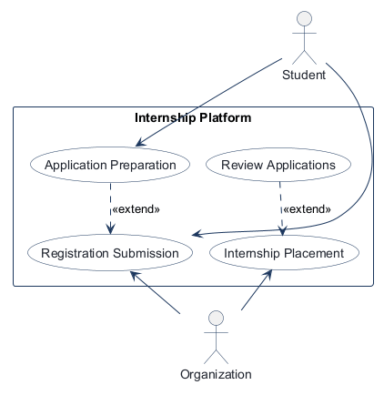
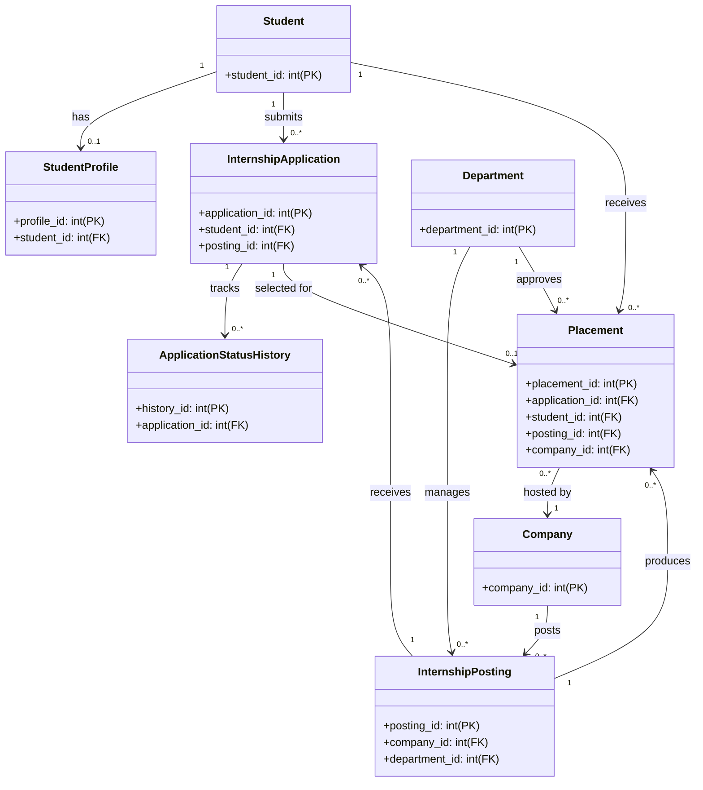

# COMP 3613 Assignment 1

Draft this file with the Guide. **Update it after every phase milestone** before you pause. The use-case diagram is a UML PNG at `docs/diagrams/use-case.png`, linked from this file as `diagrams/use-case.png` (path relative to `docs/report.md`). The model diagram is Mermaid. **Embed wireframe images** as `wireframes/<file>` (files live in `docs/wireframes/`).

Do not put your student ID in this file if you will commit it. The PDF cover adds your name and ID at export time.

## Assigned project

**Internship Platform** — a departmental system that takes student applications and distributes / matches them across internship positions offered by participating companies.

## Three workflows

### 1. Prepare Internship Application (Student)

### 2. Submit Internship Application (Student)

### 3. Review / Match Internship Placement (Organization)

## Use case diagram

**Notes (Phase 2):** Prepare Internship Application is a student-side pre-step that can support the final submission if the student is still editing profile details or draft responses. Submit Internship Application is the actual action that creates the application record. Review / Match Internship Placement is organization-side and is linked to a selected application, rather than being a separate student-facing workflow. The organization does not directly create the student record; it reviews the application and decides on placement outcomes.

## Model diagram

UML class diagram. The fields below show the conventional ID primary and foreign keys required by the relationships in the draft model; business attributes are not included yet. Update this section in Phase 5 when polish revises the model, and note what changed.

The Mermaid class diagram renders in Mermaid-compatible Markdown previews.

**Relationship notes (Phase 3):** A student may have one profile and many applications. Each internship posting can receive many applications, but a placement is created only from a selected application. A placement belongs to a single student, one posting, and one company, while the department acts as the approval authority. Application status history documents every state change from draft through review to placement or rejection.

## Wireframes

### Internship Platform Workflows

<!-- student-build:wireframe-coverage
use_case: Prepare Internship Application (Student)
image: docs/wireframes/Untitled-2026-10-11-1951.png
covered: yes
-->

<!-- student-build:wireframe-coverage
use_case: Submit Internship Application (Student)
image: docs/wireframes/Untitled-2026-10-11-1951.png
covered: yes
-->

<!-- student-build:wireframe-coverage
use_case: Review / Match Internship Placement (Organization)
image: docs/wireframes/Untitled-2026-10-11-1951.png
covered: yes
-->

## Theming

**Palette:** navy (`#173247`), teal (`#087c7a`), light grey (`#f1f4f5`), white (`#ffffff`), green (`#37845a`), and red (`#b63845`).

**Typography and tone:** Retained the starter's Fraunces display and Source Sans 3 body fonts; used a restrained, professional institutional tone.

Applied the palette and Internship Platform branding to the landing, login, and register pages. Removed the unrelated starter admin/user demo pages while preserving authentication and `/config`.

## Implementation notes

One named workflow at a time. Include verify notes and polish / model revisions (Phase 5). Do not treat the first build as final.

## Deployed app

Phase 6. Public Render URL (not localhost). Markers open this to mark the three workflows.

https://

## Logins

Every account a marker needs, including extra users you added. Starter accounts:

- bob / bobpass — regular user
- admin / adminpass — admin

## YouTube URL

## Session transcripts

Filled when the Guide builds the report: the agent writes each Guide chat to `docs/transcripts/<slug>.md` (Copilot Agent, Cursor, or OpenCode). `python manage.py report` packages them. Do not paste chats here during the build.

## Competency (student-judge)

Filled when the report is built. Guide runs student-judge, writes `docs/judge.md`, and export appends the scorecard here.

## Skill integrity

Filled by `python manage.py report`. Do not edit the course skills.
