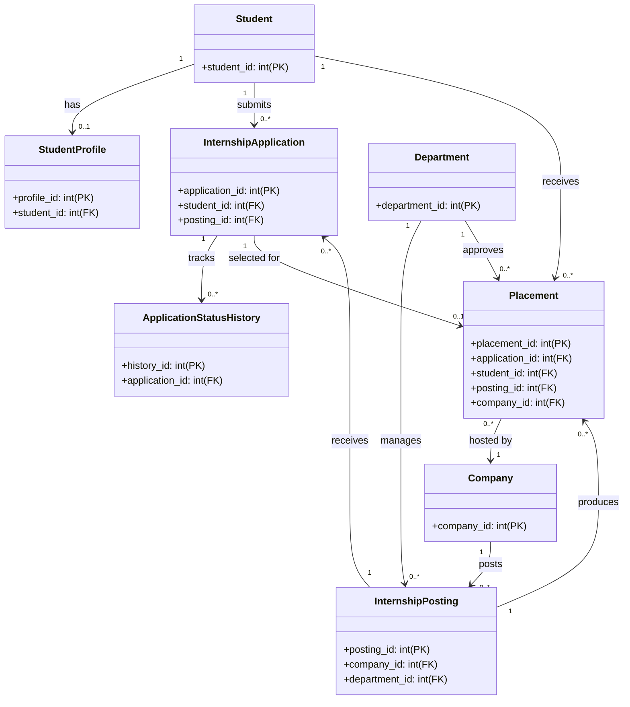
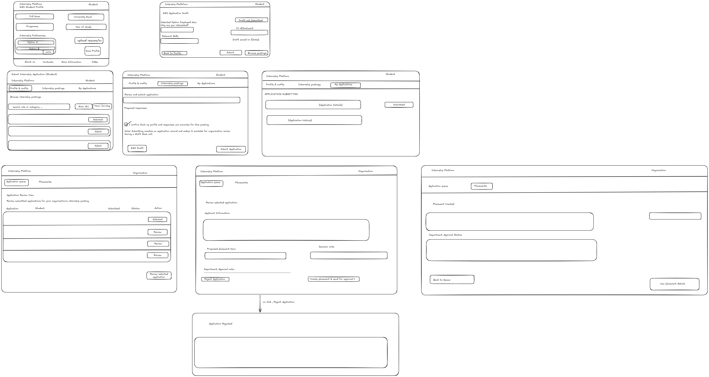

<!-- student-build:skill-integrity
status: pass
root: e84cd692d0b85eefe546385661958c27d07e8be6c5176a82012f68ccff5c8beb
expected_root: e84cd692d0b85eefe546385661958c27d07e8be6c5176a82012f68ccff5c8beb
mismatches: none
-->

# COMP 3613 Assignment 1

Draft this file with the Guide. **Update it after every phase milestone** before you pause. The use-case diagram is a UML PNG at `docs/diagrams/use-case.png`, linked from this file as `diagrams/use-case.png` (path relative to `docs/report.md`). The model diagram is Mermaid. **Embed wireframe images** as `wireframes/<file>` (files live in `docs/wireframes/`).

Do not put your student ID in this file if you will commit it. The PDF cover adds your name and ID at export time.

## Assigned project

**Internship Platform** — a departmental system that takes student applications and distributes / matches them across internship positions offered by participating companies.

## Three workflows

### 1. Prepare Internship Application (Student)

### 2. Submit Internship Application (Student)

### 3. Review / Match Internship Placement (Organization)

## Use case diagram

**Notes (Phase 2):** Prepare Internship Application is a student-side pre-step that can support the final submission if the student is still editing profile details or draft responses. Submit Internship Application is the actual action that creates the application record. Review / Match Internship Placement is organization-side and is linked to a selected application, rather than being a separate student-facing workflow. The organization does not directly create the student record; it reviews the application and decides on placement outcomes.

## Model diagram

UML class diagram. The fields below show the conventional ID primary and foreign keys required by the relationships in the draft model; business attributes are not included yet. Update this section in Phase 5 when polish revises the model, and note what changed.

The Mermaid class diagram renders in Mermaid-compatible Markdown previews.

**Relationship notes (Phase 3):** A student may have one profile and many applications. Each internship posting can receive many applications, but a placement is created only from a selected application. A placement belongs to a single student, one posting, and one company, while the department acts as the approval authority. Application status history documents every state change from draft through review to placement or rejection.

## Wireframes

### Internship Platform Workflows

<!-- student-build:wireframe-coverage
use_case: Prepare Internship Application (Student)
image: docs/wireframes/Untitled-2026-10-11-1951.png
covered: yes
-->

<!-- student-build:wireframe-coverage
use_case: Submit Internship Application (Student)
image: docs/wireframes/Untitled-2026-10-11-1951.png
covered: yes
-->

<!-- student-build:wireframe-coverage
use_case: Review / Match Internship Placement (Organization)
image: docs/wireframes/Untitled-2026-10-11-1951.png
covered: yes
-->

## Theming

**Palette (confirmed Phase 5):** navy (`#173247`), teal (`#087c7a`), light grey (`#f1f4f5`), white (`#ffffff`), green (`#37845a`), and red (`#b63845`).

**Typography and tone:** Fraunces display and Source Sans 3 body; restrained, professional institutional tone.

**Wordmark:** Internship Platform (text wordmark, no separate logo file).

Applied the palette and Internship Platform branding to the landing, login, and register pages. Removed the unrelated starter admin/user demo pages while preserving authentication and `/config`.

## Implementation notes

One named workflow at a time. Include verify notes and polish / model revisions (Phase 5). Do not treat the first build as final.

**Theming:** Student confirmed the Phase 4 palette for Phase 5. Applied to landing, login, register; starter demo pages removed, `/config` preserved.

**Model decision (Phase 5):** A `Student` is matched to a logged-in `User` by email (no `user_id` foreign key), as chosen earlier. `StudentProfile` holds the editable profile fields (`FullName`, `UniversityMail`, `Program`, `Year`, `InternshipPreference`, `resume_cv`). On the first profile save, a `Student` record is created for the user's email if none exists, so the workflow is self-contained and demoable without an admin step. The fuller 8-entity ERD (postings, applications, placements, companies, departments) remains the target model; workflows 2 and 3 build on it as they are implemented.

### 1. Prepare Internship Application (Student)

The logged-in student opens **My profile** from the landing page, views any saved profile, and creates/updates it (`StudentProfile`). The route is thin: it calls `StudentService`, which coordinates `StudentRepository`; no SQL (`select`/`db.exec`) appears in the router.

Files: `app/schemas/student.py`, `app/repositories/student.py`, `app/services/student_service.py`, `app/routers/student.py`, `app/templates/student/profile.html`, plus the **My profile** nav link in `app/templates/landing.html`.

<!-- student-build:code-check
workflow: Prepare Internship Application (Student)
form: choice
layer: model
architecture_ok: yes
implement_confidence: 0.70
passed: yes
note: Chose separate StudentProfile; drafts belong to the student. Student matched to User by email.
-->

<!-- student-build:code-check
workflow: Prepare Internship Application (Student)
form: choice
layer: route+service+repository
architecture_ok: yes
implement_confidence: 0.75
passed: yes
note: Thin router calls StudentService -> StudentRepository; no SQL in router. Profile create/update matched by email; Student auto-created on first save.
-->

**Polish (workflow 1):** Resume / CV now accepts a file upload (PDF/DOC/DOCX) instead of a text field. Uploaded files are stored under `app/static/uploads/resumes/` and the path is saved on `StudentProfile.resume_cv`; re-saving the profile without re-uploading leaves the existing file untouched. The profile view shows the current file as a downloadable link.

**Verify (next):** run `python manage.py init` then `python manage.py run`, sign in as a regular user, open My profile, upload a resume/CV file, save, and confirm it persists and reloads with a download link.

### 2. Submit Internship Application (Student)

Implemented. The logged-in student browses active `InternshipPosting`s, selects one, reviews the posting details, and submits. Submitting creates an `InternshipApplication` linked to the student (matched by email, auto-created on first use) and the posting, and records the initial `submitted` status in `ApplicationStatusHistory`. A submission confirmation page is shown afterwards.

Files: `app/models/internship.py`, `app/schemas/internship.py`, `app/repositories/internship.py`, `app/services/internship_service.py`, `app/routers/internship.py`, `app/templates/internship/postings.html`, `app/templates/internship/apply.html`, `app/templates/internship/submitted.html`, plus the **Browse postings** nav link in `app/templates/landing.html`. Models registered in `app/models/__init__.py`; router registered in `app/routers/__init__.py`.

<!-- student-build:code-check
workflow: Submit Internship Application (Student)
form: choice
layer: model
architecture_ok: yes
implement_confidence: 0.78
passed: yes
note: Added Company, Department, InternshipPosting, InternshipApplication, ApplicationStatusHistory models; student matched to User by email (auto-created on first submit).
-->

<!-- student-build:code-check
workflow: Submit Internship Application (Student)
form: choice
layer: route+service+repository
architecture_ok: yes
implement_confidence: 0.78
passed: yes
note: Thin router calls InternshipService -> InternshipRepository (+ StudentRepository); no SQL in router. Submit creates application + initial status history.
-->

**Seed data:** `python manage.py init` (or `seed`) now creates 10 demo active postings across 10 companies/departments — Software Engineering (TechNova/Engineering), Data Analytics (InsightEdge/Analytics), Product Management (ClearPath/Product), UX/UI Design (NeonWave/Design), Cybersecurity (FortressNet/Security), DevOps (CloudPulse/Infrastructure), Mobile Development (AppForge/Engineering), Marketing (BrandSpark/Marketing), Finance (Apex Capital/Finance), Human Resources (PeopleFirst/HR) — plus `bob`/`bobpass` and `admin`/`adminpass`.

**Fix:** company and department now display their names (not IDs) on the Browse postings and Apply pages.

**Verify (next):** run `python manage.py init` then `python manage.py run`, sign in as bob/bobpass, open Browse postings, confirm company/department names show, apply to a posting, and confirm the submission confirmation page shows and the application persists.

### 3. Review / Match Internship Placement (Organization)

Implemented. The organization (admin) reviews all submitted applications and creates a `Placement` from a selected application, linking it to a company. The application status is updated and recorded in `ApplicationStatusHistory`. Admin-only routes guard the organization workflow.

Files: `app/models/internship.py` (`Placement`), `app/schemas/internship.py` (`Placement*` schemas), `app/repositories/internship.py` (application listing + placement creation), `app/services/internship_service.py` (organization review service), `app/routers/internship.py` (organization routes), `app/templates/organization/applications.html`, `app/templates/organization/application_detail.html`, plus the **Review applications** nav link in `app/templates/landing.html` (admin only). Models registered in `app/models/__init__.py`; router already registered in `app/routers/__init__.py`.

<!-- student-build:code-check
workflow: Review / Match Internship Placement (Organization)
form: choice
layer: model
architecture_ok: yes
implement_confidence: 0.80
passed: yes
note: Added Placement model (application, student, posting, company, status, matched_at) matching the ERD.
-->

<!-- student-build:code-check
workflow: Review / Match Internship Placement (Organization)
form: choice
layer: route+service+repository
architecture_ok: yes
implement_confidence: 0.80
passed: yes
note: Thin router calls InternshipService -> InternshipRepository; no SQL in router. Admin-only routes (AdminDep). Placement creation updates application status + status history.
-->

**Verify (next):** run `python manage.py init` then `python manage.py run`, sign in as admin/adminpass, open Review applications, select an application, create a placement, and confirm the application status updates and the placement persists.

## Deployed app

Phase 6. Public Render URL (not localhost). Markers open this to mark the three workflows.

https://

## Logins

Every account a marker needs, including extra users you added. Starter accounts:

- bob / bobpass — regular user
- admin / adminpass — admin

## YouTube URL

## Session transcripts

Filled when the Guide builds the report: the agent writes chat markdown into `docs/transcripts/`; `python manage.py report` packages them.

Guide packaged **1** chat(s) in `docs/transcripts/` (and `docs/transcripts.zip`).

Index: [docs/transcripts/INDEX.md](transcripts/INDEX.md)

- [`report-export-2026-10-17`](transcripts/report-export-2026-10-17.md)

## Competency (student-judge)

Filled by Guide from the student-judge run when this report was built.

**Student / session:** OpenCode Guide session — report build / export (docs/report.md already present)
**Artifact:** This native OpenCode chat + current `docs/report.md`, `docs/diagrams/`, `docs/wireframes/`. No prior Guide phase transcripts are available in `docs/transcripts/` except this export-session transcript.
**Phases in evidence:** Report build / export only (COMP 3613). Phases 1–5 build work is reflected in existing `docs/report.md` artefacts but is not evidenced by any in-session Guide chat.
**Judged at:** 2026-10-17T00:00:00Z (fresh run; prior `docs/judge.md` ignored)
**Evidence pass:** re-read native chat + current docs/report.md (prior judge.md ignored)

---

### Totals

| | Count / value |
|--|--|
| Metrics on rubric | 12 (M1–M12) |
| N/A (excluded) | 9 (M1–M9; no build-phase opportunity in this export-only session) |
| Metrics scored | 3 (M10, M11, M12) |
| Scoreable max | 3 × 4 = 12 |
| Awarded total | 11 / 12 |
| **Overall (avg of scored)** | **3.67 / 4** |
| Impression mark | 18 / 20 |

---

## Scorecard

| ID | Metric | Score / 4 | In avg | Evidence |
|----|--------|----------:|:------:|----------|
| M1 | Phase discipline | N/A | no | Export-only session; no phase transitions observed in chat. |
| M2 | Problem framing | N/A | no | No project/`Feature (user)` framing elicited in this chat. |
| M3 | Decision ownership | N/A | no | No student decisions elicited in this chat. |
| M4 | Artefact-before-code | N/A | no | No code implementation in this chat. |
| M5 | Verification habit | N/A | no | No app verification run in this chat. |
| M6 | Assignment fit | N/A | no | No implementation in this chat. |
| M7 | Slice explanation | N/A | no | No explanation elicited in this chat. |
| M8 | Prompt quality | N/A | no | No phase-tagged prompts in this chat. |
| M9 | Response to pushback | N/A | no | No pushback in this chat. |
| M10 | Integrity | 4 | yes | `python manage.py skills-verify` → pass; root hash matches `.agents/skills.lock.json`; no skill files edited. |
| M11 | Provenance continuity | 3 | yes | `docs/report.md`, `docs/diagrams/use-case.*`, and `docs/wireframes/` exist and match this Internship Platform project; artefacts pre-date this export thread. |
| M12 | Sincerity trajectory | 4 | yes | No suspicion blocks; straightforward export/transcript request; no laundering indicators. |

---

## Strengths

- Skill integrity is clean: `.agents/skills/`, `.cursor/skills/`, `AGENTS.md`, and `.agents/skills.lock.json` all match the committed lock (verified with `python manage.py skills-verify`).
- `docs/report.md` is already substantially complete: all three named workflows (Prepare, Submit, Review/Match), theming palette, implementation notes with `architecture_ok: yes` code-check blocks, seed data, marker logins (`bob`/`bobpass`, `admin`/`adminpass`), use-case diagram, and wireframe embedded.
- No database password, `DATABASE_URI`, `SECRET_KEY`, or `CONFIG_PASSWORD` appears in the report (only permitted app-level marker logins).
- This transcript was written to `docs/transcripts/report-export-2026-10-17.md`.

## Gaps (priority order)

1. **No prior Guide phase transcripts available** — `docs/transcripts/` contained only this export-session transcript. For a full competency assessment, the Guide should write each prior phase chat (Phase 1–5) to `docs/transcripts/<slug>.md` before re-running `python manage.py report`. (Not an integrity failure; N/A metrics reflect missing opportunity, not a penalty.)
2. **No public Render URL** in `docs/report.md` (`## Deployed app` is a placeholder `https://`). Phase 6 deploy has not been completed; this is a Phase 6 gate note, not an M1–M9 penalty.
3. **No `docs/judge.md` pre-existed** — this file was created fresh at export time (required before a complete `python manage.py report` merge).

## Phase gate status

| Phase | Status | Note |
|-------|--------|------|
| 1 | not evidenced | No Phase 1 chat in evidence. |
| 2 | not evidenced | No Phase 2 chat in evidence. |
| 3 | not evidenced | No Phase 3 chat in evidence. |
| 4 | not evidenced | No Phase 4 chat in evidence. |
| 5 | not evidenced | No Phase 5 chat in evidence (artefacts exist in `docs/report.md` but no in-session verification/polish turns). |
| 6 | not met | No public Render URL; `## Deployed app` placeholder only. |

## Recommended next practice

Before a graded export, the student should (1) write each prior Guide phase chat into `docs/transcripts/<slug>.md`, (2) complete the Phase 6 Render deploy and add the public URL to `docs/report.md`, then (3) re-run `python manage.py report --name "..." --id "..."` so the judge re-scores from the full transcript record.

## Integrity note

- Clean — no suspected external assist, no paste-back, skills not edited (`skills-verify` pass).

## Provenance flags

- None

## Sincerity log summary

- Blocks found: 0 | max round: n/a | min/mean/final confidence: n/a | trend: n/a | cleared: n/a

## Skips

- Skips: 0/3 used (from Guide). Skips are not an integrity failure.

## Skill integrity

Course skills are hashed at export and compared to `.agents/skills.lock.json`. Do not edit `.agents/skills/`, `.cursor/skills/`, or `AGENTS.md`.

- Status: **pass**
- Root: `e84cd692d0b85eefe546385661958c27d07e8be6c5176a82012f68ccff5c8beb`
- none
